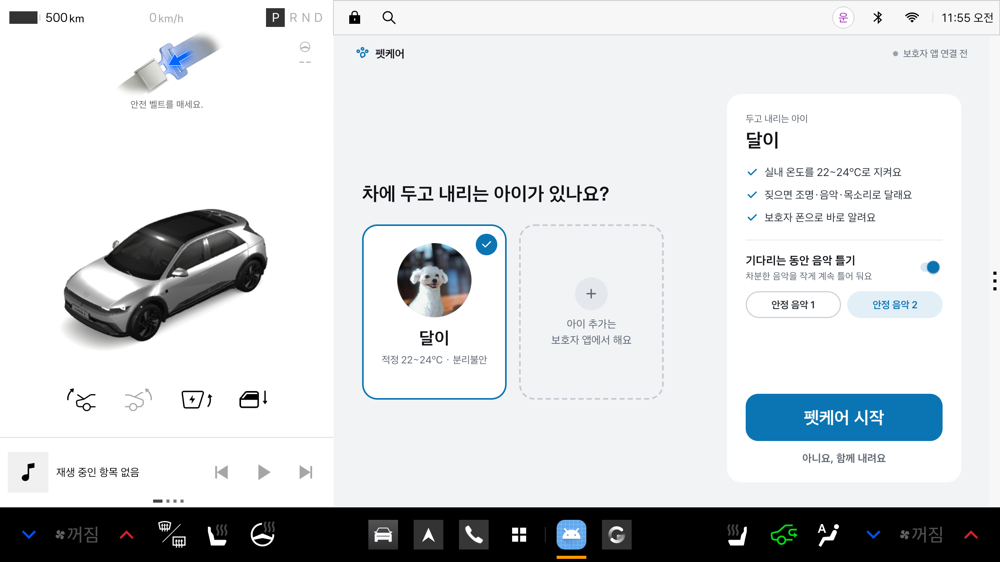
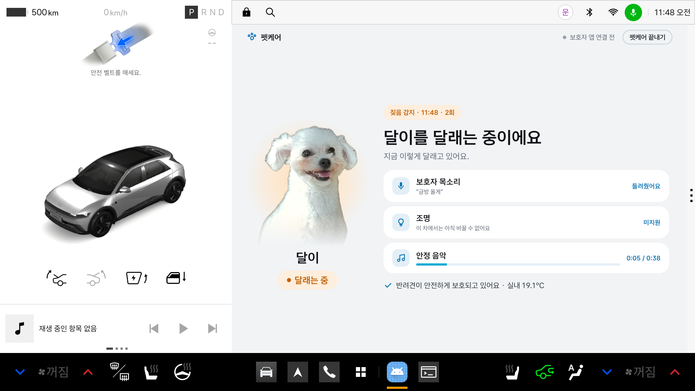
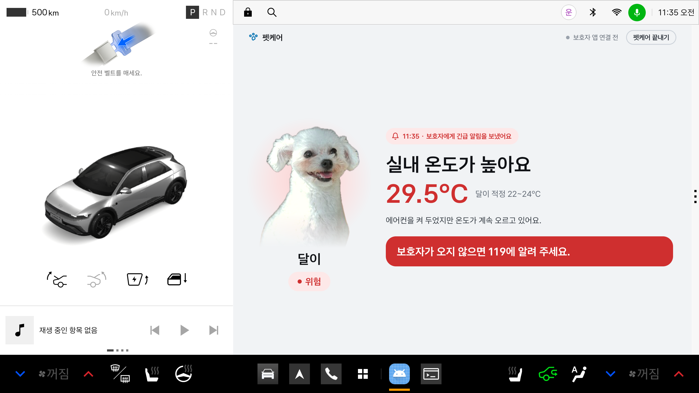

# 펫케어 드라이브 (PetCare Drive)

차에 혼자 남은 반려견의 짖음을 차가 알아듣고 달래 주고, 보호자는 폰으로 상태를 보고 알림을 받는 차량용 앱입니다.

현대자동차그룹 차량용 앱 개발 공모전 출품작 · 팀 멍대표

- 시연 영상: https://www.youtube.com/watch?v=elS34snQwyg
- 숏폼: https://www.youtube.com/shorts/KTzkv5SANrk

| 펫케어 시작 | 달래는 중 | 위험 경보 |
|---|---|---|
|  |  |  |

## 기능

**혼자 기다릴 때**
- 짖음·낑낑거림 감지: 차량 마이크 + 온디바이스 AI(YAMNet). 소리는 차 밖으로 보내지 않음
- 자동 진정: 보호자 목소리, 앰비언트 조명, 안정 음악을 동시에
- 대기 화면: 실내 온도, 혼자 있은 시간, 배터리로 버틸 시간, 주변 사람용 안심 문구
- 위험 경보: 실내 온도가 적정 범위를 크게 벗어나거나 배터리가 부족하면 위험 화면 + 긴급 알림
- 진정 완료 요약: 짖은 횟수, 진정까지 걸린 시간

**보호자 폰**
- QR로 차와 연결 (처음 한 번)
- 실시간 실내 온도·펫케어 상태
- 짖음·진정·위험 푸시 (앱이 꺼져 있어도)
- 원격 온도 조절 → 차 에어컨에 바로 적용

**운전 중**
- 반려견과 1시간 달리면 쉬어 가자고 음성 + 배너로 안내

## 바로 시연하기 (APK)

[Releases](https://github.com/tmdghks-dev/petcare-drive/releases/latest)에서 APK 두 개를 받습니다. 두 앱 모두 팀 Firebase에 연결된 빌드입니다.

**1. 차량 앱** (Pleos Connect 에뮬레이터 2.1.0)
```bash
adb -s emulator-5554 install -r PetCareDrive_car.apk
adb -s emulator-5554 shell am start --user current -n ai.petcare.drive.car/.MainActivity
```
처음 실행하면 연결 QR과 차 코드(예: `E8D9DDA8`)가 나옵니다.

**2. 보호자 앱** (Android 폰 또는 폰 에뮬레이터)
```bash
adb -s <폰> install -r PetCareDrive_phone.apk
```
앱에서 `자동차 QR 연결`로 차 화면의 QR을 찍습니다. 카메라가 없으면 차 코드로 바로 연결할 수 있습니다.
```bash
adb -s <폰> shell am start -a android.intent.action.VIEW -d "petcare://pair?car=E8D9DDA8"
```
차 화면에 `보호자 폰과 연결됐어요`가 뜨면 연결 완료입니다.

**3. 시연 신호**

에뮬레이터는 실제 온도·주행 상태를 바꿀 수 없어서 아래 신호로 상황을 만듭니다. 차 화면에서 `펫케어 시작`을 누른 뒤 보냅니다.

| 상황 | 명령 |
|---|---|
| 짖음 | `adb -s emulator-5554 shell am broadcast -a ai.petcare.drive.car.BARK` |
| 낑낑거림 | `... -a ai.petcare.drive.car.WHINE` |
| 조용해짐 | `... -a ai.petcare.drive.car.CALM` |
| 실내 온도 위험 | `... -a ai.petcare.drive.car.DANGER --ef temp 29.5` |
| 위험 해제 | `... -a ai.petcare.drive.car.SAFE` |
| 1시간 주행 (휴식 안내) | `... -a ai.petcare.drive.car.DRIVE --ei min 60` |
| 휴식 완료 | `... -a ai.petcare.drive.car.REST` |
| 목적지 도착 | `... -a ai.petcare.drive.car.ARRIVE` |

실제 소리로 시험하려면 에뮬레이터를 `-allow-host-audio`로 켜고 마이크 권한을 허용한 뒤, PC 근처에서 강아지 짖는 소리를 틉니다.

## 구성

| 폴더 | 내용 |
|---|---|
| `car-app/` | 차량 앱 · Pleos Connect, Java, Vehicle SDK 2.3.2 |
| `phone-app/` | 보호자 앱 · Flutter |
| `functions/` | 차 기록 → 보호자 폰 푸시 · Firebase Cloud Functions (Node 22) |
| `database.rules.json` | Realtime Database 규칙 (로그인한 앱만 읽기·쓰기) |
| `docs/design/ui-v2/` | 화면 시안 |

```
차량 앱 ── status·events ──▶ Realtime Database ──▶ 보호자 앱 (실시간 상태)
   ▲                              │
   └──── commands (온도 설정) ◀────┘    events ──▶ Cloud Functions ──▶ FCM 푸시
```

사용한 Vehicle SDK: HVAC(실내 온도·설정 온도), EvBattery(잔량), Light(앰비언트 조명), Gear(주행·정차). 권한은 실제로 쓰는 것만 선언했습니다.

## 소스에서 빌드

Firebase 설정 파일(`google-services.json`)은 저장소에 없습니다. 설정 파일 없이 빌드하면 Firebase 없이(폰 연결·푸시 제외) 동작합니다. 전체 기능은 Releases의 APK로 확인해 주세요.

```bash
# 차량 앱 (JDK 21)
cd car-app && ./gradlew installDebug

# 보호자 앱
cd phone-app && flutter run
```
