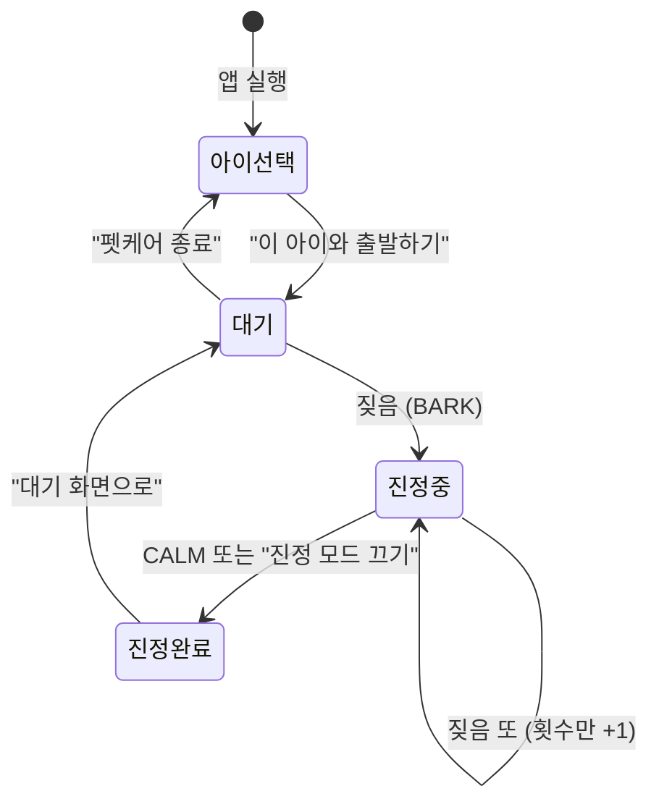
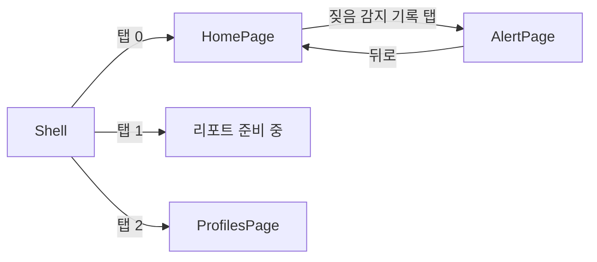

# 코드 구조

두 앱은 아직 서로 연결되지 않았다. 나중에 Firebase로 연결한다 (설계도: `petcare-architecture.html`).

```
Pleos/
├── car-app/      차량 앱 · Android Java · Pleos Vehicle SDK
├── phone-app/    보호자 앱 · Flutter (Android·iOS)
└── docs/         기획서, 명령어, 시연 영상, 이 문서
```

---

## 1. 차량 앱 (car-app)

### 파일
| 파일 | 역할 |
|---|---|
| `java/.../MainActivity.java` | 앱 전체 로직. 화면 4개 전환, 차량 데이터 읽기, 진정 동작 (약 430줄) |
| `java/.../Dog.java` | 반려견 프로필 모델 + 조사(은/는, 이/가) 함수 |
| `res/layout/screen_*.xml` | 화면 4개: `screen_profiles`, `screen_idle`, `screen_calming`, `screen_calmed` |
| `res/layout/part_*.xml` | 모든 화면 공통 조각: `part_top`(상단 상태 표시), `part_photo`(동그란 사진) |
| `res/layout/item_*.xml` | 반복 카드: `item_stat`(숫자 카드), `item_action`(진정 동작 줄), `item_dog`, `item_add`, `item_chip` |
| `res/values/colors.xml` | **디자인 색 토큰. 색은 여기서만 바꾼다** |
| `res/values/styles.xml` | 글자 크기·버튼 스타일 (`Headline`, `Sub`, `BtnPrimary`, `BtnOutline` 등) |
| `res/drawable/ic_*.xml`, `bg_*.xml` | 아이콘(벡터), 카드·버튼 배경 모양 |
| `res/raw/` | `calm_music_1·2.wav`(진정 음악), `owner_voice.wav`(보호자 목소리 샘플) |
| `AndroidManifest.xml` | 권한. Vehicle SDK는 `pleos.car.permission.*` 를 써야 동작한다 |

### 화면 흐름



화면을 바꾸는 메서드는 `show화면이름()` 형태다.

| 화면 | 메서드 | 레이아웃 |
|---|---|---|
| 함께 탈 아이 선택 | `showProfiles()` | `screen_profiles` |
| 펫케어 대기 | `showIdle()` | `screen_idle` |
| 짖음 감지 · 진정 중 | `showCalming()` (`onBark()`가 호출) | `screen_calming` |
| 진정 완료 | `onCalm()` 안에서 그림 | `screen_calmed` |

모든 화면 전환은 `setScreen(layout)` 하나를 거친다. 지금 화면은 `screen` 변수(레이아웃 id)로 안다.

### 주요 변수 (MainActivity)
| 변수 | 뜻 |
|---|---|
| `vehicle` | Pleos Vehicle SDK 진입점. `onCreate`에서 `initialize()`, `onDestroy`에서 `release()` |
| `selected` | 이번에 함께 탄 반려견들 (`Dog.ALL` 중 선택한 것) |
| `screen` | 현재 화면 레이아웃 id |
| `careStartAt` | 펫케어 시작 시각 (ms). "혼자 있던 시간" 계산용 |
| `firstBarkAt`, `barkCount` | 이번 진정의 첫 짖음 시각, 짖음 횟수 |
| `music`, `track` | 진정 음악 플레이어, 지금 곡 번호 (`MUSIC` 배열 index) |
| `lightBefore` | 조명을 바꾸기 전 상태. 진정이 끝나면 되돌린다 |
| `temp`, `battery`, `batteryNote`, `door`, `doorNote` | 차량에서 읽은 값을 화면용 글자로 저장 |
| `ui` | 메인 스레드 Handler. SDK 콜백은 백그라운드 스레드라 화면 갱신은 반드시 `ui.post` |

상수: `ACTION_BARK`/`ACTION_CALM`(데모 신호 이름), `CABIN`(조명·온도 영역), `DOORS`(문 4개), `MUSIC_TAIL_MS`(진정 후 음악을 더 트는 시간 2분)

### 차량 데이터 읽기
`readVehicle()`이 Vehicle SDK를 호출한다. 결과는 `done(...)`이 메인 스레드에서 변수에 저장하고 `renderVehicle()`로 다시 그린다.

| 값 | SDK 호출 | 권한 |
|---|---|---|
| 실내 온도 | `getHVAC().getHvacTemperatureCurrent` | `CAR_CLIMATE` |
| 배터리 % | `getEvBattery().getEvBatteryStateOfCharge` | `CAR_ENERGY` |
| 유지 시간 | `getEvBattery().getEvBatteryLevel` (Wh ÷ 1500W 가정) | `CAR_ENERGY` |
| 도어 잠금 | `getDoor().getDoorLockState` × 문 4개 → `door()`가 모아서 판단 | `CAR_DOORS` |
| 조명 | `getLight().setAmbientLight...` (`calmLight()`, `restoreLight()`) | `CAR_LIGHTS`, `CONTROL_CAR_LIGHTS` |

SDK 콜백은 Kotlin 람다라 Java에서는 마지막에 `return Unit.INSTANCE;` 가 필요하다.

### 짖음 감지 시 동시에 하는 일 (`showCalming()`)
1. `notifyOwner()` → 보호자 알림 (지금은 Firebase 연결 전이라 "연결 전" 표시만)
2. `calmLight()` → 앰비언트 조명 켜기 (에뮬레이터에서는 거부되어 "미지원")
3. `startMusic()` → 진정 음악 반복 재생, `musicTick`이 1초마다 진행 막대 갱신

### 화면 조각 헬퍼
화면마다 같은 코드를 반복하지 않도록 만든 함수들.

| 함수 | 하는 일 |
|---|---|
| `top(label, strong, meta)` | 상단 상태 표시. `strong=true`면 진한 파랑(진정 중) |
| `hero(strongRing)` | 동그란 반려견 사진 |
| `stat(id, icon, label, value, note)` | 숫자 카드 하나 채우기 (`icon=0`이면 아이콘 숨김) |
| `action(id, icon, title, sub, status)` | 진정 동작 줄 하나 채우기 |
| `circle(res)` | 세로 사진을 정사각형으로 잘라 원형으로 |
| `names()` | "달이" 또는 "달이 외 1마리" |
| `Dog.josa(name, 받침O, 받침X)` | "달이는 / 별은", "달이가 / 별이" |

### 아직 대체해 둔 것 (코드에 `ponytail:` 주석으로 표시)
- 짖음 감지 → adb `BARK` 신호. 마이크 감지가 붙으면 `onBark()`만 호출하면 된다
- 보호자 알림 → Firebase 연결 후 구현
- 반려견 목록 → `Dog.ALL`에 고정. 폰 앱에서 받아오도록 교체
- 유지 시간 → 공조 1.5kW 고정 가정

---

## 2. 보호자 앱 (phone-app)

### 파일
| 파일 | 역할 |
|---|---|
| `lib/main.dart` | 앱 시작, 하단 메뉴(`Shell`: 홈·리포트·프로필), 리포트 자리 화면 |
| `lib/home.dart` | 홈 화면 `HomePage`: 상태 카드 4개, 오늘 기록, 목소리 버튼 |
| `lib/alert.dart` | 짖음 알림 화면 `AlertPage`: 차에서 동시에 실행 중인 동작, 대응 버튼 |
| `lib/profiles.dart` | 반려견 프로필 `ProfilesPage`: 여러 마리 선택·추가·수정 |
| `lib/data.dart` | 데이터 모델과 데모 값, 조사 함수 |
| `lib/theme.dart` | **디자인 색 토큰(`C`)과 공통 위젯**. 차량 앱 `colors.xml`과 값이 같아야 한다 |
| `test/widget_test.dart` | 테스트 3개: 홈→알림 이동, 아이 추가, 조사 |
| `assets/dali.jpg` | 데모 반려견 사진 |

### 화면 흐름



### 데이터 (`data.dart`)
| 이름 | 뜻 |
|---|---|
| `Dog` | 반려견 (`name`, `photo`, `breed`, `age`, `tempMin`, `tempMax`, `anxious`, `voiceCount`) |
| `CarStatus` | 차량 상태 (`temp`, `battery`, `careHours`, `locked`, `place`) |
| `LogEntry` | 오늘 기록 한 줄 (`time`, `text`, `value`, `bark`) |
| `dogs` | 등록된 반려견 목록 (지금은 달이 1마리로 시작) |
| `demoStatus`, `demoLog` | **데모 값**. Firebase 연결 후 실제 구독 데이터로 교체 |
| `josa()` | 차량 앱 `Dog.josa`와 같은 조사 함수 |

### 공통 위젯 (`theme.dart`)
| 위젯 | 시안의 어느 부분 |
|---|---|
| `C` | 색 토큰 (`C.primary`, `C.tint` 등) |
| `StatusPill` | 왼쪽 위 상태 표시 (`strong: true`면 진정 중) |
| `DogPhoto` | 동그란 반려견 사진 + 연한 파랑 테두리 |
| `IconTile` | 연한 파랑 칸 안의 아이콘 |
| `CardBox` | 흰 카드 |
| `PrimaryButton`, `OutlineButton` | 파랑 버튼, 테두리 버튼 |
| `toast()` | 아래쪽 안내 메시지 |

### 프로필 화면 상태 (`_ProfilesPageState`)
| 이름 | 뜻 |
|---|---|
| `current` | 지금 보고 있는 반려견 index |
| `name`, `breed`, `age` | 입력칸 컨트롤러 |
| `_select(i)` / `_load()` | 다른 아이 선택 → 입력칸에 그 아이 정보 채움 |
| `_add()` | "새 아이" 추가 후 선택 |
| `_save()` | 입력값을 `Dog`에 저장 (아직 앱 안에서만, 끄면 사라짐) |

---

## 3. 두 앱이 지켜야 할 약속
- **색:** `car-app/res/values/colors.xml` ↔ `phone-app/lib/theme.dart`의 `C` 값이 같아야 한다
- **반려견 프로필 필드:** 차량 `Dog.java` ↔ 폰 `data.dart`의 `Dog`가 같은 항목을 가진다. Firebase `profile` 구조도 이 필드를 따른다
- **용어:** 펫케어 대기 / 짖음 감지·진정 중 / 진정 완료. 두 앱 화면 문구를 같게 쓴다
